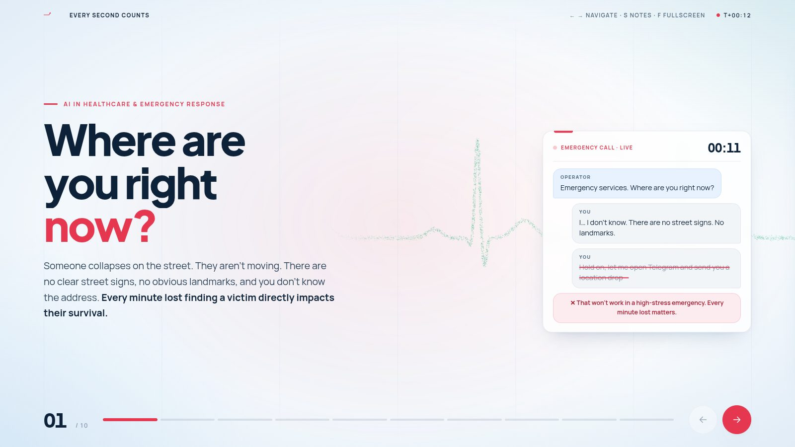
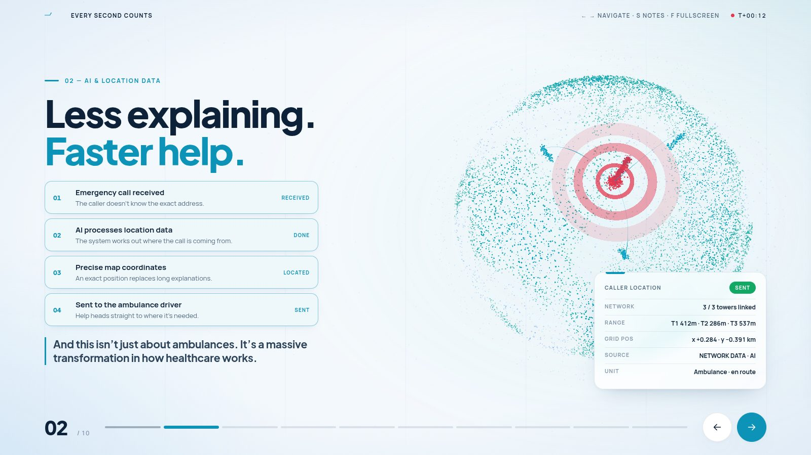
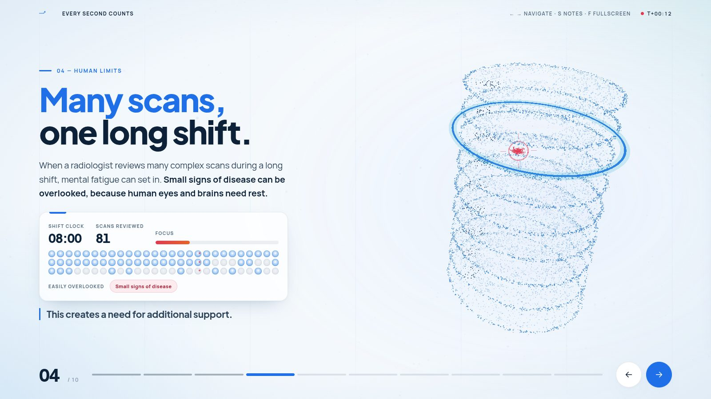
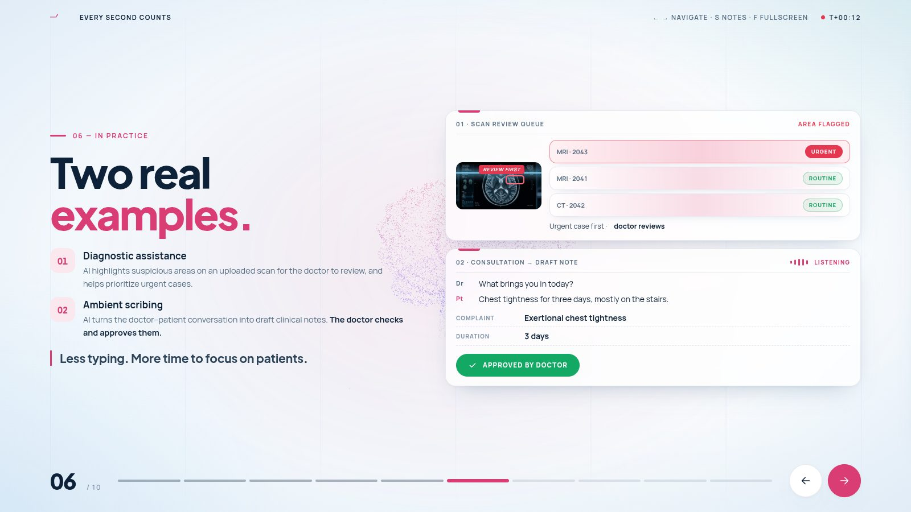
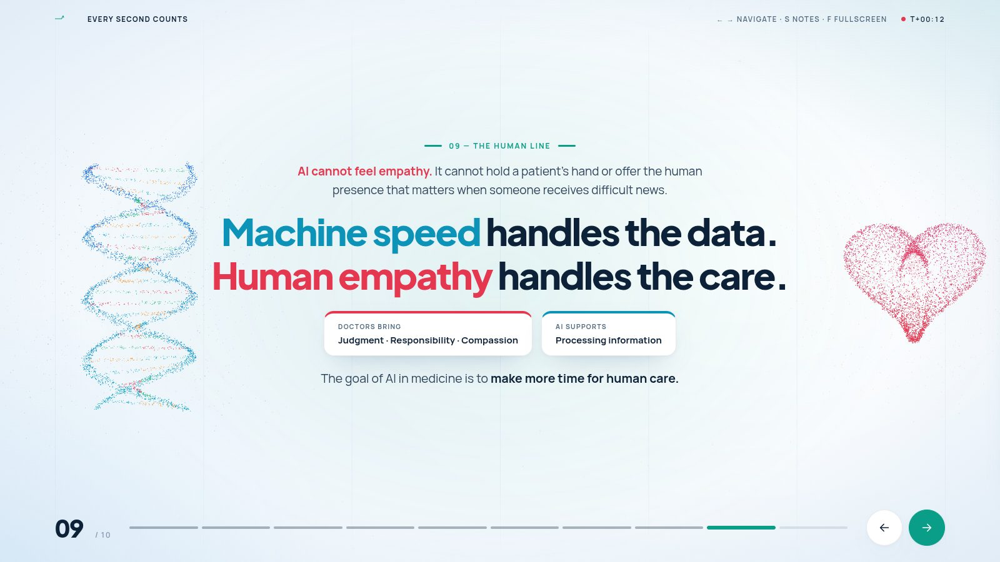
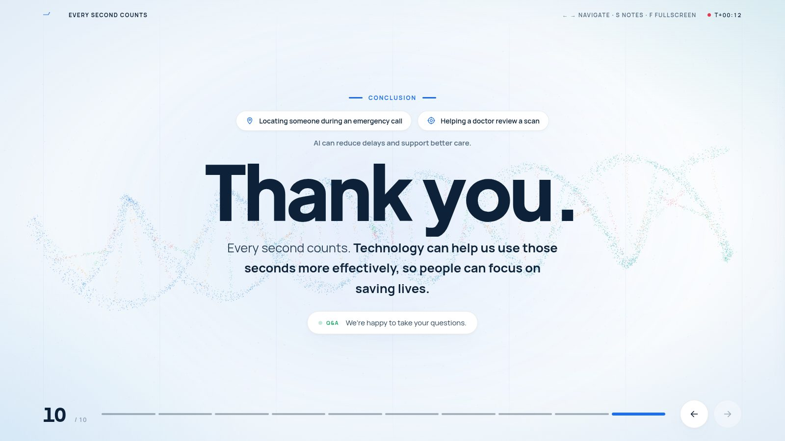

<div align="center">



# 🫀 Every Second Counts

### AI in Healthcare & Emergency Response — an interactive 3D pitch deck

*A browser-based presentation where a living cloud of 16,000 particles morphs between<br>an ECG trace, a globe, a CT scan, a neural network, DNA and a beating heart as you speak.*

<br>


**[▶ Quick start](#-quick-start)** · **[🎮 Controls](#-controls)** · **[🗂 Slides](#-the-10-slides)** · **[⚙️ How it works](#%EF%B8%8F-how-it-works)** · **[🛠 Customising](#-customising)**

</div>

---

## ✨ Highlights

| | Feature | What it means |
|:-:|---|---|
| 🌐 | **One persistent 3D world** | A single WebGL particle field never reloads. It **morphs** from one medical shape to the next on every slide, with colour, depth and motion blending on the GPU. |
| 🎬 | **Every slide is a scene** | Calls type themselves out, the AI links cell towers to locate the caller, scans get triaged, a draft clinical note fills itself in. Each slide plays a short story timed to the script. |
| 🩺 | **Bright medical design** | A clean clinical palette (white glass, blue, teal and coral) with one accent colour per slide. Two typefaces: *Plus Jakarta Sans* and *Manrope*. |
| 🎤 | **Built for presenting** | Arrow-key navigation, a built-in **speaker-notes panel** with the full script, a running timer, fullscreen mode and deep links to any slide. |

---

## 🚀 Quick start

No install, no build, no server. Just open the file:

```bash
# from this folder
xdg-open index.html        # Linux
open index.html            # macOS
start index.html           # Windows
```

Then press **`F`** for fullscreen and **`→`** to begin.

> [!TIP]
> Three.js is bundled locally in `vendor/`, so the deck runs from `file://` and works **offline**. Only the two web fonts come from Google Fonts. Without internet the deck still works and falls back to system fonts.

> [!NOTE]
> If you prefer a local server (e.g. to test on a phone on the same Wi-Fi):
> ```bash
> python3 -m http.server 8000   # then visit http://localhost:8000
> ```

---

## 🎮 Controls

| Key | Action |
|:---:|---|
| <kbd>→</kbd> &nbsp; <kbd>Space</kbd> &nbsp; <kbd>PgDn</kbd> | Next slide |
| <kbd>←</kbd> &nbsp; <kbd>PgUp</kbd> | Previous slide |
| <kbd>Home</kbd> / <kbd>End</kbd> | Jump to first / last slide |
| <kbd>S</kbd> | Toggle **speaker notes** (the exact script for the current slide) |
| <kbd>F</kbd> | Toggle fullscreen |
| 👆 Swipe | Next / previous on touch screens |
| 🖱 Move the mouse | Subtle parallax on the 3D scene |
| 🔗 `index.html#6` | Open directly on slide 6 (works for `#1` – `#10`) |

The on-screen ← → buttons and the progress bar at the bottom do the same.

---

## 🗂 The 10 slides

Each slide matches one *`[N-slayd ochiladi]`* cue in **`Pitch_Script_4_Speakers.pdf`**.

| # | Slide | 3D scene | What animates |
|:-:|---|---|---|
| 1 | **Where are you right now?** | 💓 ECG heartbeat sweep | A live emergency call types itself out; the “send a location drop” idea gets struck through |
| 2 | **Less explaining. Faster help.** | 🌍 Globe with signal arcs | Four-step pipeline runs; 3 cell towers link up, measure range, and fix the caller's position on the network grid |
| 3 | **Cognitive overload** | 📄 Storm of paperwork | Screens · typing · forms: where a doctor's day goes |
| 4 | **Many scans, one long shift** | 🩻 CT scan stack with moving gantry | Shift clock runs to 08:00, focus drains, late scans start getting missed |
| 5 | **Clinical co-pilot** | 🧠 Neural network with travelling signals | Switch flips from *Autopilot* ✗ to *Co-pilot* ✓ |
| 6 | **Two real examples** | 🧠 Brain with MRI scan band | AI flags an MRI and moves it to the top of the queue; a conversation becomes a draft note → **doctor approves** |
| 7 | **Will AI replace doctors?** | 🪐 Orbital rings | 3D tilt card: the calculator lesson from history |
| 8 | **Technology changes what we do** | 🌌 Particle galaxy | Photography → painting, computers → offices |
| 9 | **Machine speed · Human empathy** | 🧬 DNA ⟷ ❤️ heart | The core idea, split between data and care |
| 10 | **Thank you** | 🧬 Flowing DNA ribbon | Recap, Q&A |

<details>
<summary><b>📸 More screenshots</b></summary>
<br>

| | |
|:-:|:-:|
|  |  |
| **2 · AI locates the caller through the network** | **4 · Many scans, one long shift** |
|  |  |
| **6 · Diagnostic assistance & ambient scribing** | **9 · Machine speed handles the data** |
|  |  |
| **10 · Thank you & Q&A** | **1 · Where are you right now?** |

</details>

---

## ⚙️ How it works

```mermaid
flowchart LR
    K([⌨️ Arrow key / swipe]) --> GO[go&#40;i&#41;]
    GO --> UI[🎨 DOM<br/>reveal · scramble · accent colour]
    GO --> SC[🎬 Slide scene<br/>async storyline]
    GO --> M[🔀 morphTo&#40;shape&#41;]
    M --> GPU[(🟦 WebGL shader<br/>16k particles)]
    GPU --> X[✨ 3D extras<br/>arcs · rings · gantry · signals]
    style GPU fill:#e8f2fe,stroke:#1e6fe8
    style SC fill:#e6f7f4,stroke:#0a9e88
```



- **Particles on the GPU.** Every shape (helix, ECG, globe, CT, brain, neural net, heart, galaxy…) is generated once at load time as 16,000 positions, colours and intensities. Switching slides “freezes” the current blend and hands the new target to a custom `ShaderMaterial`, which flies each particle to its new place with a staggered, eased arc.
- **Shader modes.** The same shader also draws the **ECG sweep**, the **MRI scan band** and a world-space fade that keeps particles out from behind the text.
- **Pre-warmed.** All shaders and 3D extras are compiled behind the loading screen, so no slide stutters the first time it appears.
- **Scenes.** Each slide has an `async` storyline in `main.js`. Leaving a slide cancels its storyline straight away, so you can skip ahead at any time without glitches.
- **Responsive.** On small screens the particle count drops to 9,000 and the layout stacks vertically. If your system has *reduced motion* turned on, the spinning slows down.

### 📁 Project structure

```text
presentation/
├── index.html          ← all 10 slides + hidden speaker notes
├── style.css           ← medical light theme, cards, slide layouts
├── main.js             ← 3D engine, shapes, slide config, scenes, navigation
├── vendor/
│   └── three.min.js    ← Three.js r149 (bundled for offline use)
├── assets/             ← slide imagery (.webp)
└── docs/               ← README screenshots
```

---

## 🛠 Customising

<details>
<summary><b>✏️ Change slide text or speaker notes</b></summary>
<br>

Everything lives in `index.html`. Each slide is a `<section class="slide">`, and the speaker notes are the hidden `<div class="notes">` inside it. Whatever you put there shows up when you press <kbd>S</kbd>. Hand-off cues use `<p class="handoff">`.

</details>

<details>
<summary><b>🎨 Change a slide's 3D shape, position or colour</b></summary>
<br>

Edit the `CFG` array near the top of `main.js`. There is one entry per slide:

```js
{shape:'globe', pos:[3.0,.15,0], rot:[.22,-.32,0], sway:.45, extra:'globe', accent:'#0e93b8'}
```

| Field | Meaning |
|---|---|
| `shape` | `ecg` `globe` `papers` `ct` `neural` `brain` `rings` `galaxy` `split` `finale` `helix` `heart` `wave` |
| `pos` / `rot` / `scale` | Where the shape sits in 3D space |
| `spinY` / `spinX` / `sway` | Continuous rotation or gentle rocking |
| `mode` | `1` ECG sweep · `2` MRI scan band |
| `extra` | Extra 3D objects: `globe` `ct` `neural` `brain` |
| `accent` | The slide's highlight colour (UI + progress bar) |
| `op` | Particle opacity (lower = text reads better) |
| `center` | `true` for centred layouts |

</details>

<details>
<summary><b>🌈 Change the colour theme</b></summary>
<br>

The palette is a set of CSS variables at the top of `style.css`:

```css
--bg:#f3f8fc; --fg:#0d2238; --blue:#1e6fe8; --teal:#0a9e88; --red:#e5374f; ...
```

</details>

---

## 💡 Presenting tips

1. Open the deck **before** you are called up. The loader builds the 3D shapes in about a second.
2. Press <kbd>F</kbd> for fullscreen, then <kbd>S</kbd> if you want the script on screen while rehearsing.
3. Let each slide's animation play: they last roughly as long as the matching lines in the script.
4. Need to jump back for a question? Use <kbd>Home</kbd>, or add `#N` to the URL.

> [!IMPORTANT]
> The numbers shown in the animations (tower ranges, grid position, scan IDs, the patient conversation) are **illustrative**. They show how the systems work and are not real patient or location data.

---

<div align="center">

**Every second counts. Technology can help us use those seconds more effectively,<br>so people can focus on saving lives.**

<sub>Made with HTML, CSS, JavaScript & Three.js · No frameworks · No build step</sub>

</div>
